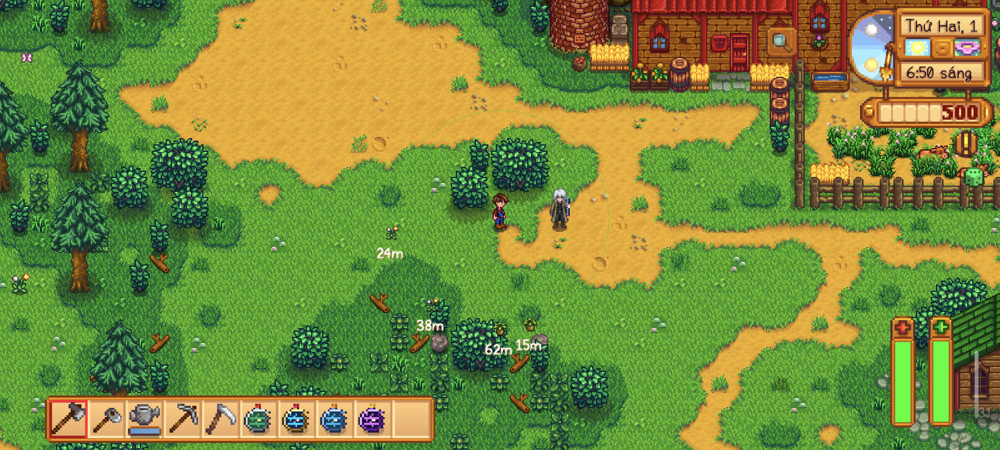
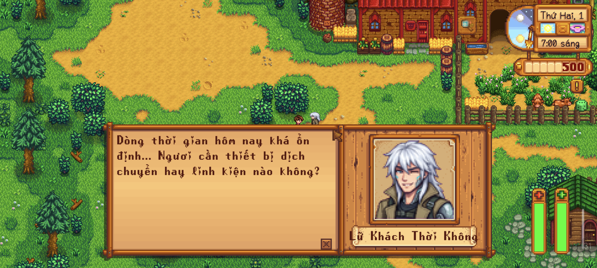
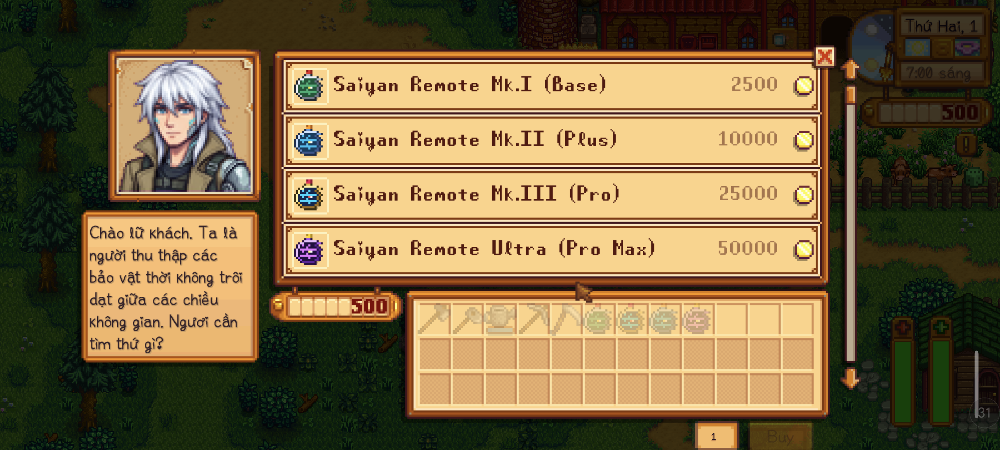

# [CP] Chrono Merchant (v1.0.0)

**Tác giả:** dinhmaiphuong2025  
**Yêu cầu:** Stardew Valley 1.6+ | SMAPI 4.0+ | Content Patcher 2.0+  
**Nền tảng hỗ trợ:** Android (Cinderbox / SMAPI Android) & PC (Windows / Linux / macOS)  

---

## 1. Giới Thiệu (Overview)

**Chrono Merchant (Thương Nhân Thời Không)** là bản mod NPC du mục độc lập sử dụng Content Patcher. Một lữ khách thời gian nửa người nửa máy (cyborg) với mái tóc trắng wolf-cut bụi bặm, áo khoác khaki phiêu lưu và cánh tay cơ khí tương lai. 

Anh ta lang thang qua các dòng thời gian để thu thập các bảo vật công nghệ thất lạc và xuất hiện tại thung lũng Stardew để giao thương với người chơi.

---

## 📸 Hình Ảnh Trực Quan Trong Game (Screenshots)

| Thương nhân tại Rừng Cindersap | Hộp thoại trò chuyện & Chân dung |
| :---: | :---: |
|  |  |

| Giao diện Cửa hàng Chrono Shop bán Saiyan Remotes |
| :---: |
|  |

---

## 2. Vị Trí & Lịch Trình (Location & Schedule)

- **Vị trí:** Rừng Cindersap (`Forest`), tọa độ `(81, 23)` — nằm ngay tại bãi đất cỏ rộng rãi thoáng đãng phía trước Trang trại Marnie.
- **Giờ xuất hiện:** `06:00` sáng mỗi ngày.
- **Giờ rời đi:** `20:00` tối (8:00 PM). Khi đến giờ đóng cửa:
  - Thương nhân vung cánh tay cơ khí **xé toạc một vết nứt thời không** phát sáng năng lượng vũ trụ.
  - Anh ta bước vào vết nứt và **đóng cổng không gian**, biến mất hoàn toàn khỏi bản đồ cho tới sáng hôm sau!

---

## 3. Hoạt Ảnh Nhàn Rỗi (Idle Animations)

Khi rảnh rỗi giữa các lượt khách ghé thăm, Thương nhân sẽ tự động biểu diễn 2 động tác đặc trưng:
1. **Tung Đồng Xu Thời Gian (Coin Flip):** Cánh tay cơ khí co lên, búng ngón tay hất đồng xu vàng xoay tít lên không trung, lấp lánh tia sáng ở đỉnh điểm rồi chụp lại gọn gàng vào lòng bàn tay kèm tiếng leng keng.
2. **Xé Vết Nứt Không Gian (Spacetime Rift):** Cánh tay kim loại phát sáng năng lượng Cyan và Violet, rạch một đường nứt thời không giữa không trung kèm âm thanh cổng ma thuật trầm sâu êm dịu, trước khi vết rách tan biến thành các hạt bụi sao.

---

## 4. Danh Mục Cửa Hàng & Bảng Giá (Chrono Shop Inventory)

Mod cung cấp **2 chế độ giá** phù hợp với sở thích của người chơi:
- **Bản Rẻ (Casual — Mặc định):** Giá dễ tiếp cận, mua trải nghiệm sớm ngay năm 1.
- **Bản Cân Bằng (Balanced):** Giá theo tiến trình RPG bậc thang.

| Vật Phẩm | Mô Tả | Giá Bản Rẻ (Casual) | Giá Bản Cân Bằng (Balanced) |
| :--- | :--- | :---: | :---: |
| **Saiyan Remote Mk.I (Base)** | Điều khiển tàu Saiyan bản chuẩn (2 lần/ngày) | **2,500g** | 5,000g |
| **Saiyan Remote Mk.II (Plus)** | Bản Cobalt, tốc độ +60% (5 lần/ngày) | **10,000g** | 15,000g |
| **Saiyan Remote Mk.III (Pro)** | Bản Titan mạ vàng, tốc độ cao (10 lần/ngày) | **25,000g** | 40,000g |
| **Saiyan Remote Ultra (Pro Max)** | Bản Iridium tối thượng, vô hạn lần, vượt mọi rào cản | **50,000g** | 100,000g |
| **Pin (Battery Pack)** | Nguồn năng lượng dự trữ Capsule Corp | 2,500g | 3,000g |
| **Thỏi Iridium (Iridium Bar)** | Kim loại ngoài hành tinh cao cấp | 8,000g | 10,000g |
| **Warp Totem: Farm** | Vật tổ dịch chuyển về Nông trại | 1,000g | 1,000g |
| **Warp Totem: Desert** | Vật tổ dịch chuyển tới Sa mạc Calico | 2,500g | 2,500g |

> *Mẹo tương tác:* Đứng cách thương nhân trong phạm vi **1 ô đất liền kề** và bấm/chạm vào nhân vật. Sau câu thoại chào mừng, menu cửa hàng sẽ tự động mở ra ngay!

---

## 5. Cấu Hình & Hai Bản Phát Hành (Release Options)

Bạn có thể tải trực tiếp file zip cài đặt sẵn theo mức giá mong muốn, hoặc chỉnh sửa file `config.json` trong thư mục mod:
- `ChronoMerchant_v1.0.0_Casual_Prices.zip` (Mặc định: `"PriceMode": "Casual"`)
- `ChronoMerchant_v1.0.0_Balanced_Prices.zip` (Cài sẵn: `"PriceMode": "Balanced"`)

---

## 6. Hướng Dẫn Cài Đặt (Installation)

1. Cài đặt **SMAPI** và **Content Patcher** bản mới nhất.
2. Tải 1 trong 2 file `.zip` phù hợp ở mục 5 bên trên.
3. Giải nén thư mục `[CP] ChronoMerchant` vào thư mục `Mods`:
   - **PC:** `Stardew Valley/Mods/`
   - **Android (Cinderbox):** `/storage/emulated/0/StardewValley/desktop/Mods/`
4. Khởi động game và tận hưởng!
